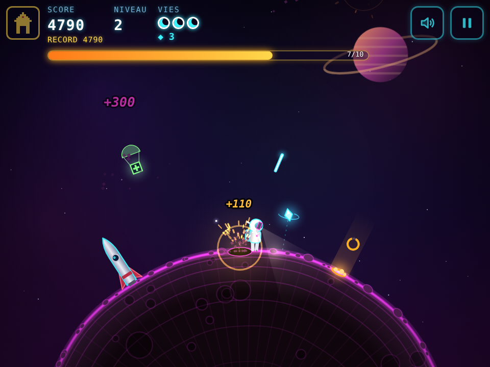

*[English version below](#english)*

# ASTRO PIOCHE

Petit jeu rétro jouable dans le navigateur. Un astronaute creuse les zones qui clignotent à la surface d'un astéroïde, tire sur les météorites, puis repart en fusée. Attraper la soucoupe bonus donne une vie en plus.

Le jeu existe en trois versions graphiques rétro et un **Remake** moderne. Chaque version tient dans une seule page qui se joue au clavier sur ordinateur et au tactile sur mobile : les boutons tactiles n'apparaissent que sur les appareils tactiles.

| Version | Page (tactile + clavier) |
|---|---|
| Atari 2600 | `2600.html` |
| Courante (moderne) | `courante.html` |
| Amstrad CPC (mode 0) | `cpc.html` |
| ASTRO PIOCHE Remake (néon) | `moderne.html` |

Les anciennes adresses `2600-touch.html`, `courante-touch.html` et `cpc-touch.html` redirigent vers la page unique correspondante (les favoris et raccourcis existants continuent de marcher).

La page `index.html` propose toutes les versions, avec leurs captures et de fausses boîtes de jeu (dans `img/`).

   

## Commandes

### Versions 2600, courante et CPC (`2600.html`, `courante.html`, `cpc.html`)

**Au clavier** (sur ordinateur)
- Flèches gauche/droite ou `Q`/`D` (clavier AZERTY) : se déplacer
- Flèche bas ou `S` : creuser
- `Espace`, `K` ou `Entrée` : tirer
- `P` : pause
- `M` : couper ou remettre le son
- `Échap` : retour à l'accueil (avec confirmation)

**En tactile** (iPhone / iPad) : les boutons ◀ ▶ sont à gauche, CREUSER et FEU à droite, et n'apparaissent que sur un appareil tactile. Le multi-touch est géré. Le bouton maison en haut à gauche ramène à l'accueil.

### ASTRO PIOCHE Remake (`moderne.html`)

Version néon sur un astéroïde rond qui tourne, avec effets de lumière, particules et musique synthwave générée en direct. Nouveautés : combos quand on enchaîne les zones, minerai rare ◆ (y compris en orbite basse, à attraper en sautant), rochers qui roulent et fissures à sauter au jetpack, soucoupe qui lâche une capsule de vie, améliorations entre les niveaux (pioche, blaster, bouclier).

- **Au clavier** : flèches gauche/droite ou `Q`/`D` pour marcher, flèche bas ou `S` pour creuser, `Espace` pour tirer (visée assistée, gauche/droite maintenu pour pencher le tir), flèche haut ou `Z` pour le jetpack, `P` pause, `M` son, `Échap` retour à l'accueil. Dans la boutique : `1`, `2`, `3` pour acheter, `Entrée` pour décoller.
- **En tactile** : ◀ ▶ en bas à gauche ; FEU, CREUSER et SAUT en bas à droite (multi-touch). Boutons son et pause en haut à droite.

Le meilleur score est gardé dans le navigateur (localStorage).

## Lancer le jeu

Chaque page est un fichier HTML autonome, sans dépendance : il suffit de l'ouvrir dans un navigateur.

Pour y jouer depuis un téléphone sur le même Wi-Fi, servez le dossier en local :

```sh
python3 -m http.server 8600
```

Ensuite, ouvrez `http://<IP-de-la-machine>:8600` sur le téléphone. Utilisez l'adresse IP : Chrome ne résout pas toujours les noms en `.local`.

## Crédits

Jeu imaginé par Olivier Bordereau. Graphismes rétro réalisés avec OldGraphics, y compris les assets CPC qui respectent les contraintes du mode 0 (160×200, 16 encres prises dans la palette matérielle de 27 couleurs).

## Licence

Ce projet est publié sous licence [CC BY-NC-SA 4.0](https://creativecommons.org/licenses/by-nc-sa/4.0/deed.fr). Vous pouvez le partager et le modifier à trois conditions : citer l'auteur, ne pas en faire un usage commercial et redistribuer vos modifications sous la même licence. Voir le fichier `LICENSE`.

---

<a id="english"></a>

# ASTRO PIOCHE (English)

A small retro game that runs in the browser. An astronaut digs the blinking spots on an asteroid's surface, shoots down meteorites, then flies off in a rocket. Catching the bonus flying saucer gives you an extra life.

The game comes in three retro graphic styles plus a modern **Remake**. Each version is a single page that plays with the keyboard on a computer and with touch on mobile: the touch buttons only appear on touch devices.

| Version | Page (touch + keyboard) |
|---|---|
| Atari 2600 | `2600.html` |
| Standard (modern) | `courante.html` |
| Amstrad CPC (mode 0) | `cpc.html` |
| ASTRO PIOCHE Remake (neon) | `moderne.html` |

The old `2600-touch.html`, `courante-touch.html` and `cpc-touch.html` addresses redirect to the matching single page, so existing bookmarks and home-screen shortcuts keep working.

`index.html` lists every version, with screenshots and mock game boxes (in `img/`).

## Controls

### 2600, Standard and CPC versions (`2600.html`, `courante.html`, `cpc.html`)

**Keyboard** (on a computer)
- Left/right arrows or `A`/`D` (`Q`/`D` on AZERTY): move
- Down arrow or `S`: dig
- `Space`, `K` or `Enter`: fire
- `P`: pause
- `M`: mute or unmute sound
- `Esc`: back to the home page (with confirmation)

**Touch** (iPhone / iPad): the ◀ ▶ buttons are on the left, DIG (CREUSER) and FIRE (FEU) on the right; they only appear on touch devices. Multi-touch is supported. The house button at the top left goes back to the home page.

### ASTRO PIOCHE Remake (`moderne.html`)

A neon version on a round, rotating asteroid, with lighting effects, particles and live-generated synthwave music. New: combos for chaining digs, rare ◆ ore (including ore floating in low orbit that you grab by jumping), rolling boulders and fissures to jump over with the jetpack, a saucer that drops an extra-life capsule, and upgrades between levels (pickaxe, blaster, shield).

- **Keyboard**: left/right arrows or `A`/`D` (`Q`/`D` on AZERTY) to walk, down arrow or `S` to dig, `Space` to fire (auto-aim; hold left/right to tilt your shot), up arrow or `W` (`Z` on AZERTY) for the jetpack, `P` pause, `M` sound, `Esc` back to the home page. In the shop: `1`, `2`, `3` to buy, `Enter` to take off.
- **Touch**: ◀ ▶ bottom left; FIRE (FEU), DIG (CREUSER) and JUMP (SAUT) bottom right (multi-touch). Sound and pause buttons top right.

The high score is saved in the browser (localStorage).

## Running the game

Each page is a standalone HTML file with no dependencies, so you can just open it in a browser.

To play from a phone on the same Wi-Fi network, serve the folder locally:

```sh
python3 -m http.server 8600
```

Then open `http://<machine-IP>:8600` on the phone. Use the IP address, because Chrome doesn't always resolve `.local` names.

## Credits

Game created by Olivier Bordereau. Retro graphics made with OldGraphics, including CPC assets that respect the real mode 0 limits (160×200, 16 inks from the 27-color hardware palette).

## License

This project is licensed under [CC BY-NC-SA 4.0](https://creativecommons.org/licenses/by-nc-sa/4.0/). You may share and adapt it as long as you give credit, don't use it commercially, and distribute your changes under the same license. See the `LICENSE` file.
