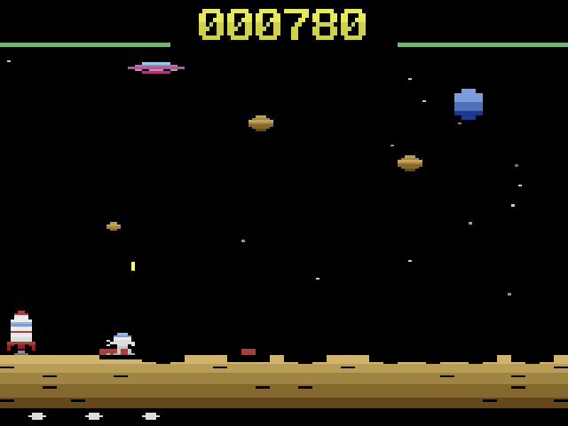
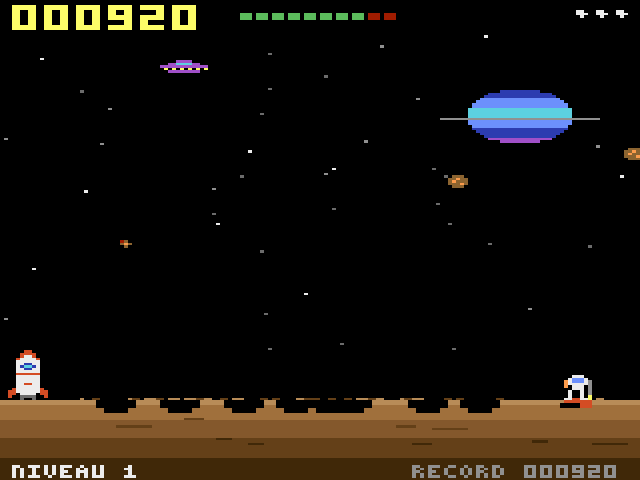
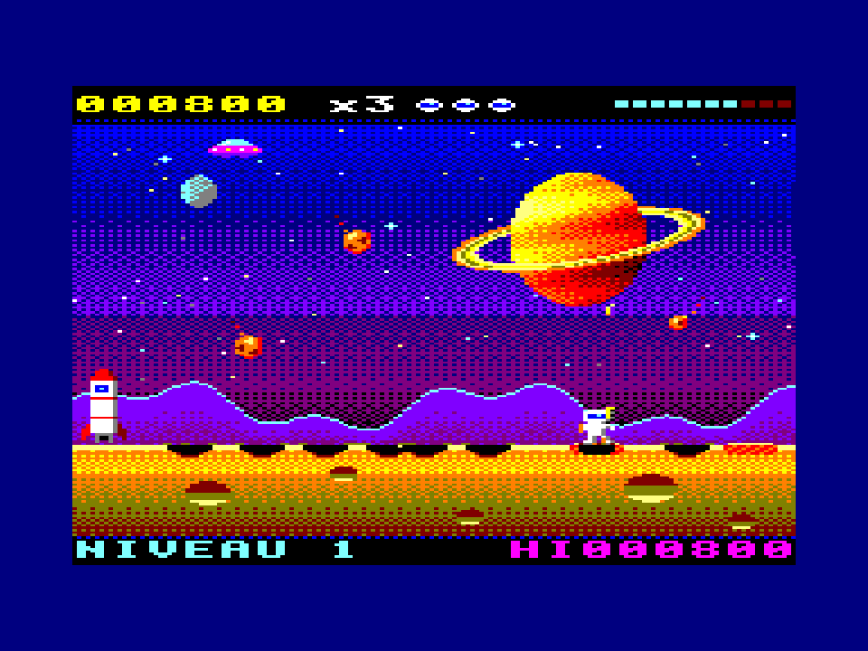

*[English version below](#english)*

# ASTRO PIOCHE

Petit jeu rétro jouable dans le navigateur. Un astronaute creuse les zones qui clignotent à la surface d'un astéroïde, tire sur les météorites, puis repart en fusée. Attraper la soucoupe bonus donne une vie en plus.

Le jeu existe en trois versions graphiques, chacune avec une variante clavier et une variante tactile pour mobile.

| Version | Clavier | Tactile |
|---|---|---|
| Atari 2600 | `2600.html` | `2600-touch.html` |
| Courante (moderne) | `courante.html` | `courante-touch.html` |
| Amstrad CPC (mode 0) | `cpc.html` | `cpc-touch.html` |

La page `index.html` propose toutes les versions, avec leurs captures et de fausses boîtes de jeu (dans `img/`).

  

## Commandes

**Au clavier**
- Flèches gauche/droite ou `A`/`D` : se déplacer
- Flèche bas ou `S` : creuser
- `Espace`, `K` ou `Entrée` : tirer
- `P` : pause
- `M` : couper ou remettre le son

**En tactile** : les boutons ◀ ▶ sont à gauche, CREUSER et FEU à droite. Le multi-touch est géré.

Le meilleur score est gardé dans le navigateur (localStorage).

## Lancer le jeu

Chaque page est un fichier HTML autonome, sans dépendance : il suffit de l'ouvrir dans un navigateur.

Pour y jouer depuis un téléphone sur le même Wi-Fi, servez le dossier en local :

```sh
python3 -m http.server 8600
```

Ensuite, ouvrez `http://<IP-de-la-machine>:8600` sur le téléphone. Utilisez l'adresse IP : Chrome ne résout pas toujours les noms en `.local`.

## Crédits

Jeu imaginé par Olivier Bordereau. Graphismes rétro réalisés avec OldGraphics, y compris les assets CPC qui respectent les contraintes du mode 0 (160×200, 16 encres prises dans la palette matérielle de 27 couleurs).

## Licence

Ce projet est publié sous licence [CC BY-NC-SA 4.0](https://creativecommons.org/licenses/by-nc-sa/4.0/deed.fr). Vous pouvez le partager et le modifier à trois conditions : citer l'auteur, ne pas en faire un usage commercial et redistribuer vos modifications sous la même licence. Voir le fichier `LICENSE`.

---

<a id="english"></a>

# ASTRO PIOCHE (English)

A small retro game that runs in the browser. An astronaut digs the blinking spots on an asteroid's surface, shoots down meteorites, then flies off in a rocket. Catching the bonus flying saucer gives you an extra life.

The game comes in three graphic styles, each with a keyboard version and a touch version for mobile.

| Version | Keyboard | Touch |
|---|---|---|
| Atari 2600 | `2600.html` | `2600-touch.html` |
| Standard (modern) | `courante.html` | `courante-touch.html` |
| Amstrad CPC (mode 0) | `cpc.html` | `cpc-touch.html` |

`index.html` lists every version, with screenshots and mock game boxes (in `img/`).

## Controls

**Keyboard**
- Left/right arrows or `A`/`D`: move
- Down arrow or `S`: dig
- `Space`, `K` or `Enter`: fire
- `P`: pause
- `M`: mute or unmute sound

**Touch**: the ◀ ▶ buttons are on the left, DIG (CREUSER) and FIRE (FEU) on the right. Multi-touch is supported.

The high score is saved in the browser (localStorage).

## Running the game

Each page is a standalone HTML file with no dependencies, so you can just open it in a browser.

To play from a phone on the same Wi-Fi network, serve the folder locally:

```sh
python3 -m http.server 8600
```

Then open `http://<machine-IP>:8600` on the phone. Use the IP address, because Chrome doesn't always resolve `.local` names.

## Credits

Game created by Olivier Bordereau. Retro graphics made with OldGraphics, including CPC assets that respect the real mode 0 limits (160×200, 16 inks from the 27-color hardware palette).

## License

This project is licensed under [CC BY-NC-SA 4.0](https://creativecommons.org/licenses/by-nc-sa/4.0/). You may share and adapt it as long as you give credit, don't use it commercially, and distribute your changes under the same license. See the `LICENSE` file.
